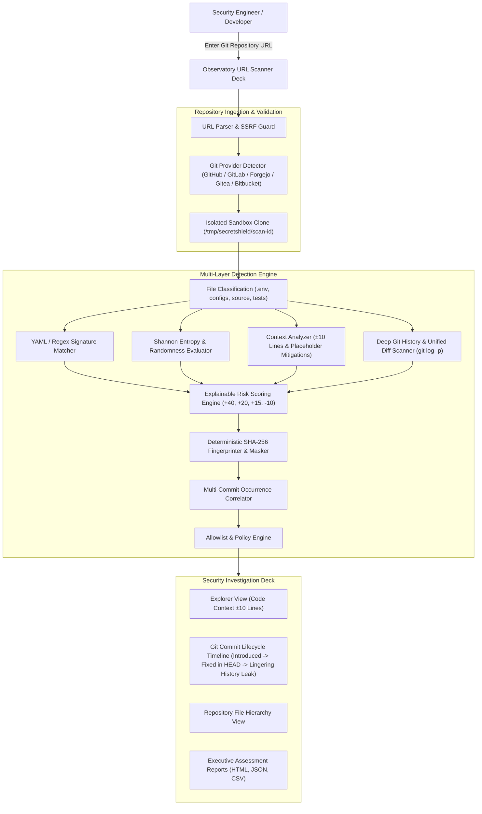

# SecretShield — Repository Security Observatory

> **Scan repositories. Detect secrets. Prevent exposure.**

SecretShield is a Git repository secrets detection and credential exposure monitoring platform designed around the **Repository Security Observatory** architecture. It enables users to paste any Git repository URL (GitHub, GitLab, Forgejo, Gitea, Bitbucket, self-hosted, or local Git repositories), securely clones into isolated sandboxes, and inspects working files and deep Git history to identify accidentally committed credentials.

---

## Observatory Architecture



---

## Key Capabilities

1. **URL-First Scanner**: Direct URL input with auto-detection of GitHub, GitLab, Forgejo, Gitea, Bitbucket, and generic Git hosts.
2. **Deep Git History Intelligence**: Detects credentials committed in past revisions even after being removed from the current working tree (`HEAD`).
3. **Shannon Entropy Analysis**: Statistical evaluation of high-randomness character distributions with false-positive filtering for UUIDs, hashes, and common words.
4. **Context-Aware Analysis**: Examines $\pm 10$ lines of code surrounding each detection to reduce noise from test mocks, documentation placeholders, and comments.
5. **Explainable Risk Scoring**: Itemized 0–100 scoring model explaining every rating (`+40 AWS Pattern`, `+20 High Entropy`, `+15 .env file`, `+15 Git history`, `-10 Test directory`).
6. **Masked Secret Previews & SHA-256 Fingerprints**: Sensitive payloads are never persisted in plaintext (`AKIA************MPLE`, `sk_l****************2345`).
7. **Interactive Commit Lifecycle Timeline**: Visually diagrams the trajectory of a secret: when it was added, modified, deleted from HEAD, and whether it still persists in Git history.
8. **Pre-Commit Hook & CI/CD Pipelines**: Includes `secretshield install-hook` to block commits locally, plus ready-to-use GitHub Actions and GitLab CI templates.
9. **Auditor-Grade Security Reports**: Exports executive HTML reports with live previews, machine-readable JSON for CI/CD gates, and CSV spreadsheets.

---

## Quick Start (CLI)

```bash
# Scan a remote Git repository URL
python3 cli/secretshield.py scan https://github.com/organization/project.git

# Scan current directory working tree and full commit history
python3 cli/secretshield.py scan . --history

# Scan staged changes only (pre-commit hook mode)
python3 cli/secretshield.py scan . --staged

# Machine-readable JSON output for CI/CD gates
python3 cli/secretshield.py scan . --format json
```

### Install Pre-Commit Hook
```bash
python3 cli/secretshield.py install-hook
```

---

## Docker Deployment

To launch the full production stack:

```bash
docker compose up --build
```

Access the Observatory at `http://localhost:3000`.

---

## Security Disclaimer

SecretShield is designed exclusively for defensive security auditing and scanning repositories you are authorized to inspect. Discovered secrets are strictly masked and never transmitted to external services. The platform never executes repository code, scripts, or package lifecycle hooks.
